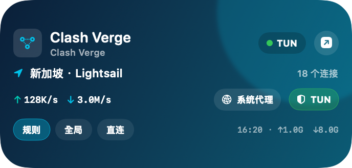

# Clash Verge Widget for macOS

[English](README.md) | [简体中文](README.zh-CN.md)

A native, draggable desktop widget for [Clash Verge Rev](https://github.com/clash-verge-rev/clash-verge-rev) on macOS. Monitor live traffic and switch Rule, Global, Direct, System Proxy, and TUN without bringing the Clash Verge window to the front.

<p align="center">
  
</p>

<p align="center"><sub>The production SwiftUI desktop panel, rendered with privacy-safe sample data.</sub></p>

## Features

- Compact 344 × 164 native desktop card that stays above desktop icons and across Spaces
- Drag from the title area to reposition it; the position is saved and kept within screen bounds
- Live upload/download rates, cumulative traffic, and active connection count
- One-click switching between Rule, Global, and Direct modes
- One-click toggles for System Proxy and TUN
- Every action is verified against the real Clash Verge state before success is shown
- Clash Verge remains hidden while controls are used
- Starts automatically for the current macOS user
- No global hotkeys and no dependency on a visible menu bar icon, including when Hidden Bar is used
- Right-click to refresh; use the top-right button or double-click the card to open Clash Verge

## Requirements

- macOS 14 or later
- Swift 6 and a recent Xcode installation for building from source
- Clash Verge Rev installed and running
- Accessibility permission for `Clash Verge Widget`

Tested end-to-end with Clash Verge Rev 2.5.10 on macOS.

## Quick Start

```bash
git clone https://github.com/guishiw/clash-verge-widget-macos.git
cd clash-verge-widget-macos
./Scripts/install.sh
```

The installer builds the project, installs `Clash Verge Widget.app` into `~/Applications`, registers the included WidgetKit extension, and starts the desktop panel through a per-user LaunchAgent.

## First-time Setup

1. Open **System Settings → Privacy & Security → Accessibility**.
2. Enable **Clash Verge Widget**.
3. Open the Clash Verge main window once so the background host can connect to its WebView.
4. Close the Clash Verge window if desired. The widget continues to control it while the window remains hidden.

Input Monitoring and Screen Recording are not required. If Clash Verge, the widget host, or the embedded WebView restarts, open the Clash Verge window once again to rebuild the cached accessibility connection.

## How It Works

Clash Verge Rev 2.5.10 does not expose a complete external control API. This project uses macOS Accessibility to activate Clash Verge's own UI controls. Changes therefore pass through Clash Verge's normal React/Tauri callbacks, keeping its runtime, persisted configuration, tray state, privileged service, TUN state, and system proxy state synchronized.

The widget reads runtime status from the current user's private Mihomo Unix socket. A small local bridge lets the WidgetKit extension and desktop panel share status; it listens only on `127.0.0.1` and requires a fresh random token embedded for each build.

The practical ad-hoc-signed installation is the movable desktop panel shown above. The repository also includes the small and medium WidgetKit extension source. Adding that extension through the macOS widget gallery requires signing with an Apple Developer Team Identifier.

## Build, Test, and Preview

```bash
./Scripts/build.sh
swift test
./Scripts/preview.sh
```

Useful registration check:

```bash
pluginkit -m -p com.apple.widgetkit-extension \
  -i com.local.ClashVergeWidget.Extension -A -D -vv
```

## Uninstall

```bash
./Scripts/uninstall.sh
```

The script stops the LaunchAgent, unregisters the extension, and moves the installed app to the Trash. Source files, logs, and Clash Verge data are left untouched.

## Privacy and Security

- No subscription URLs, credentials, proxy secrets, or user configuration are collected or stored.
- The repository does not bundle Clash Verge binaries, icons, subscriptions, or user data.
- The widget does not edit Clash Verge YAML files or macOS proxy settings directly.
- The Mihomo control socket is accessed only under the current user account.
- The local bridge is loopback-only and authenticated with a build-time random token.
- Control failures are reported; the widget never displays an optimistic state before the real transition is verified.
- `GeneratedBridgeSecret.swift` contains only a development placeholder in source control. The build script restores that placeholder even if a build fails.

## Known Limitations

- The control integration relies on the accessibility structure exposed by Clash Verge's embedded WebView and may need updates for future Clash Verge releases.
- After Clash Verge, the widget host, or its WebView restarts, open the Clash Verge main window once to rebuild the cached connection.
- The current release has been validated against Clash Verge Rev 2.5.10.
- `com.local.*` bundle identifiers are suitable for local builds. Distributors should replace them with identifiers under their own reverse-DNS namespace.

## Project Layout

```text
Sources/ClashVergeWidgetCore       Runtime status, bridge, and control logic
Sources/ClashVergeWidgetHost       Movable desktop panel and background host
Sources/ClashVergeWidgetExtension  WidgetKit extension
Sources/PreviewRenderer            Privacy-safe screenshot renderer
Scripts                            Build, install, preview, and uninstall tools
Tests                              Swift Testing suites
```

Contributions and compatibility reports for newer Clash Verge Rev releases are welcome.

## License

Released under the [MIT License](LICENSE).

## Disclaimer

This is an independent community project and is not affiliated with or endorsed by the Clash Verge Rev project. Clash Verge and related names belong to their respective owners.
