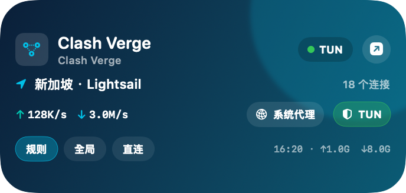

# Clash Verge macOS 桌面小组件

[English](README.md) | [简体中文](README.zh-CN.md)

一个适用于 [Clash Verge Rev](https://github.com/clash-verge-rev/clash-verge-rev) 的原生、可拖动 macOS 桌面小组件。无需把 Clash Verge 主窗口切到前台，即可查看实时流量并切换规则、全局、直连、系统代理和 TUN。

<p align="center">
  
</p>

<p align="center"><sub>生产版 SwiftUI 桌面面板，使用不包含个人信息的示例数据渲染。</sub></p>

## 功能

- 344 × 164 原生桌面卡片，显示在桌面图标上方并支持所有 Space
- 按住标题区域拖动，自动保存位置并限制在屏幕范围内
- 实时显示上下行速率、累计流量和活动连接数
- 一键切换规则、全局和直连模式
- 一键开关系统代理和 TUN
- 操作完成后读取真实状态，确认成功后才更新提示
- 操作时保持 Clash Verge 主窗口隐藏
- 当前 macOS 用户登录后自动启动
- 无需全局快捷键，也不依赖可见的菜单栏图标；使用 Hidden Bar 也不受影响
- 右键立即刷新；点击右上角按钮或双击卡片可打开 Clash Verge

## 环境要求

- macOS 14 或更高版本
- 从源码构建需要 Swift 6 和较新的 Xcode
- 已安装并正在运行 Clash Verge Rev
- 为 `Clash Verge Widget` 开启辅助功能权限

已在 macOS 上配合 Clash Verge Rev 2.5.10 完成端到端实测。

## 快速开始

```bash
git clone https://github.com/guishiw/clash-verge-widget-macos.git
cd clash-verge-widget-macos
./Scripts/install.sh
```

安装脚本会构建项目，把 `Clash Verge Widget.app` 安装到 `~/Applications`，注册随附的 WidgetKit 扩展，并通过当前用户的 LaunchAgent 启动桌面面板。

## 首次设置

1. 打开 **系统设置 → 隐私与安全性 → 辅助功能**。
2. 允许 **Clash Verge Widget**。
3. 打开一次 Clash Verge 主窗口，让后台 Host 建立 WebView 控制连接。
4. 随后可以关闭 Clash Verge 主窗口；窗口隐藏时，小组件仍可完成切换。

无需开启“输入监控”或“屏幕录制”。如果 Clash Verge、小组件 Host 或内嵌 WebView 重启，请再次打开一次 Clash Verge 主窗口，以重新建立缓存的辅助功能连接。

## 工作原理

Clash Verge Rev 2.5.10 没有向独立小组件提供完整的外部控制 API。本项目通过 macOS 辅助功能激活 Clash Verge 自身的界面控件，因此操作仍会经过 Clash Verge 原有的 React/Tauri 回调，使运行状态、持久化配置、托盘状态、特权服务、TUN 和系统代理保持同步。

小组件通过当前用户私有的 Mihomo Unix Socket 读取运行状态。一个小型本地 Bridge 负责在 WidgetKit 扩展和桌面面板之间共享状态；它只监听 `127.0.0.1`，每次构建都会嵌入新的随机令牌进行校验。

上图所示的可移动桌面面板是默认临时签名安装后的实际运行版本。仓库同时保留小号和中号 WidgetKit 扩展源码；如需通过 macOS 小组件库添加该扩展，需要使用包含 Apple Developer Team Identifier 的证书重新签名。

## 构建、测试与预览

```bash
./Scripts/build.sh
swift test
./Scripts/preview.sh
```

可使用以下命令检查 WidgetKit 扩展注册状态：

```bash
pluginkit -m -p com.apple.widgetkit-extension \
  -i com.local.ClashVergeWidget.Extension -A -D -vv
```

## 卸载

```bash
./Scripts/uninstall.sh
```

脚本会停止 LaunchAgent、注销扩展，并把已安装 App 移到废纸篓。源码、日志和 Clash Verge 数据不会被删除。

## 隐私与安全

- 不收集或保存订阅地址、凭据、代理密钥或用户配置。
- 仓库不包含 Clash Verge 二进制、图标、订阅或用户数据。
- 小组件不会直接修改 Clash Verge YAML 或 macOS 代理设置。
- Mihomo 控制 Socket 只在当前用户账户下访问。
- 本地 Bridge 只监听回环地址，并使用构建时生成的随机令牌鉴权。
- 操作失败会明确提示；真实状态未改变前不会显示乐观成功状态。
- 版本库中的 `GeneratedBridgeSecret.swift` 只有开发占位值，即使构建失败，构建脚本也会自动还原占位值。

## 已知限制

- 控制功能依赖 Clash Verge 内嵌 WebView 暴露的辅助功能结构，未来 Clash Verge 版本可能需要适配。
- Clash Verge、小组件 Host 或 WebView 重启后，需要打开一次 Clash Verge 主窗口来重建缓存连接。
- 当前版本已针对 Clash Verge Rev 2.5.10 验证。
- `com.local.*` Bundle Identifier 适合本机构建；二次发行时建议替换为维护者自己的反向域名标识。

## 项目结构

```text
Sources/ClashVergeWidgetCore       运行状态、Bridge 与控制逻辑
Sources/ClashVergeWidgetHost       可移动桌面面板与后台 Host
Sources/ClashVergeWidgetExtension  WidgetKit 扩展
Sources/PreviewRenderer            不包含个人信息的截图渲染器
Scripts                            构建、安装、预览和卸载工具
Tests                              Swift Testing 测试
```

欢迎提交贡献，也欢迎反馈新版本 Clash Verge Rev 的兼容性情况。

## 许可证

本项目采用 [MIT License](LICENSE)。

## 免责声明

本项目是独立的社区项目，与 Clash Verge Rev 项目不存在隶属或官方背书关系。Clash Verge 及相关名称归其各自权利人所有。
